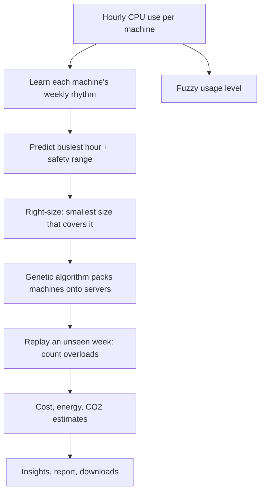
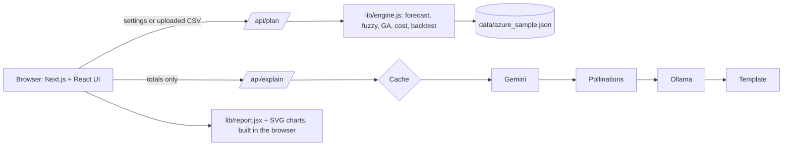

<div align="center">

# ⚡ IdleWatt
### Stop paying for cloud capacity nobody uses.
*A plain-English cost, energy and risk planner for cloud teams, built on real Microsoft Azure usage data.*

[](https://nextjs.org) [](https://react.dev) [](https://vercel.com/new) [](https://github.com/Azure/AzurePublicDataset/blob/master/AzurePublicDatasetV2.md) [](https://ai.google.dev/gemini-api/docs/pricing) [](https://pollinations.ai) [](https://ollama.com) [](https://nodejs.org/api/test.html)

</div>

## In one minute
Companies rent far more cloud capacity than they use, because nobody wants to be the person who slowed a system down. **IdleWatt answers three questions:** *how much are we wasting? what should we change? how risky is the change?* It does this on real usage data, shows its working, and **tests its own advice on a week it never saw**.

Open the app and the first screen tells you, in a sentence, how many servers you could remove and how many dollars that saves.

## Who is it for?
| Person | What they get |
|---|---|
| **Cloud cost (FinOps) teams** | Waste sized in dollars, a ranked action plan, and a tested risk number to defend it |
| **Data scientists / platform engineers** | Inspectable forecast, fuzzy classes, GA packing, a trade-off analysis, and bring-your-own-data |
| **Sustainability and finance leads** | Energy and CO₂ estimates beside the money, in a shareable report |
| **Students and researchers** | A transparent, testable alternative to black-box sizing tools |

## Real-world use cases
1. **Quarterly cloud-bill review**: find machines that are paid for but barely used.
2. **Before a migration or data-centre exit**: learn how many servers you really need.
3. **Dev/test clean-up**: spot machines that can be off at night and weekends.
4. **Sustainability reporting**: estimate energy and carbon avoided by consolidating.
5. **Capacity planning**: see how much saving each extra bit of risk buys.

## What you get
| Feature | Why it matters |
|---|---|
| Plain-English headline, insight cards and next steps | Anyone can understand it, with links to the detail behind each claim |
| Friendly machine names (“User-facing app 07”, “Background job 12”) | No random IDs |
| Forecast with safety range, replayed on unseen data | Shows the advice would have worked |
| Fuzzy usage levels (mostly unused / moderately used / heavily used) | Borderline machines are not forced into one box |
| Genetic-algorithm server packing + load map | Fewer servers, and you can see the spare room hour by hour |
| Money-vs-risk trade-off chart (18 scenarios) and one-click presets | Choose how cautious or bold to be |
| **Bring your own data** (CSV upload + example file) | Works on your fleet, not only the sample |
| Long shareable report (HTML, Word, PDF) with charts embedded | Forward to a manager |
| Action-plan CSV, machines CSV, full-plan JSON | Hand the work to engineers |
| **Quality tab**: is the safety range honest, does it beat simple guesses, how close is the packing to the theoretical minimum | Evidence you can defend, not just a number |
| Off-hours scheduling estimate and saved scenarios you can compare | FinOps-style what-if work |
| Light, dark and auto themes; guide, glossary, FAQ built in | Self-explanatory |
| Optional AI commentary: cache → Gemini → Pollinations → Ollama → template | Free; always falls back so nothing breaks |

## How it works

1. **Learn and predict.** With three weeks of history, the tool learns each machine's hour-of-week pattern and adds a 95% safety range.
2. **Right-size.** Each machine gets the smallest standard size covering its predicted peak plus your safety cushion. If the data includes Azure's 30-day p95 of peak CPU, the larger of the two is used.
3. **Pack.** A genetic algorithm tries thousands of arrangements and keeps the one needing the fewest servers.
4. **Test.** The unseen week is replayed. We count machine-hours above the new size and server-hours out of room.

## Architecture

| Layer | Technology |
|---|---|
| UI | Next.js 14 (App Router), React 18, hand-written SVG charts, CSS variables for themes |
| API | Next.js route handlers on Vercel serverless functions; the report is assembled in the browser |
| Engine | Pure JavaScript: seasonal forecast, fuzzy membership, genetic algorithm |
| Data | Azure Public Dataset V2 (real), plus a synthetic demo generator |
| AI text (optional) | Gemini free tier, Pollinations (no key), Ollama (local), fixed template |
| Tests | `node --test`, 26+ tests across engine, data, AI chain, insights and CSV |
| CI | GitHub Actions: validate data, test, build |

## The data
* **Real**: `data/azure_sample.json` holds 269 long-running VMs from the [Azure Public Dataset V2](https://github.com/Azure/AzurePublicDataset/blob/master/AzurePublicDatasetV2.md), 660 hourly points each (27.5 days). Sized on the first 504 hours, tested on the last 156.
* **Demo**: a generator for demonstrations. **Your own**: upload a CSV with the header `machine,cores,hour,cpu_percent` (4+ machines, 24+ hourly rows each; under about 4 MB on Vercel).
* **Rebuild or enlarge the real sample** (streams about 180 files of 856 MB, never stores them, around 50 minutes, resumable):
```bash
python3 scripts/build_real_sample.py --parts parts --files 180 --last 180 --vms 300 --hours 660 --workers 4 --merge
```

## Quick start
```bash
npm install
npm test
npm run dev        # http://localhost:3000
```
## Deploy on Vercel
Push to GitHub, then **Import project** on Vercel and deploy. **No environment variables are required.** Optional: copy `.env.example`; set `GEMINI_API_KEY` (free) for AI commentary. Ollama works only on your own machine.

## API
| Endpoint | Body | Returns |
|---|---|---|
| `POST /api/plan` | `n, headroom, target, price, seed, source, vms?` | the plan, charts data, load map |
| `POST /api/plan` with `sweep: true` | same | the 18 trade-off scenarios |
| `POST /api/explain` | `{ kpi }` | `{ text, source }` |

## What we measured about ourselves
On the real sample the 95% safety range holds about **91%** of the time (it was 81% before we validated it on unseen weeks, which is why the forecast now uses leave-one-week-out residuals). On demo data it holds 95%. On real data, simply repeating last week is about as accurate as our weekly pattern, so the safety range, not the point forecast, is what protects you. Likewise, on this real fleet a simple biggest-first rule already reaches the theoretical minimum of 6 servers, so the genetic algorithm ties it; the search earns its keep on harder mixes of machine sizes. The Quality tab shows all of this live.

## Honest limits
* Only **processor** use is measured. Memory, disk and network must be checked before acting.
* The sample is long-running VMs from one public trace, many very lightly used, so “unused” counts are high.
* Savings are compared with a fixed baseline: current sizes packed to 80% of a server. Cost, energy and CO₂ use editable assumptions (server $/hour, a 150–400 W power curve, 0.4 kg CO₂/kWh): estimates only.
* Free AI tiers have rate limits; cached and template answers keep the app working. Pollinations was not reachable from the build sandbox, so its step is untested.
* [AWS Compute Optimizer](https://docs.aws.amazon.com/compute-optimizer/latest/ug/what-is-compute-optimizer.html) already recommends sizes. IdleWatt is the open, explainable, testable version.

## Project layout
```
app/
  page.jsx                 state, routing, data loading
  components/              Header, Sidebar, Overview, Machines, Servers, Tradeoffs, Quality, Report, Guide, charts (SVG)
  api/{plan,explain,health,dataset}/route.js
lib/
  engine/                  common, data, forecast, fuzzy, ga, quality, schedule, validate, plan, sweep
  ai/                      providers (Gemini, Pollinations, Ollama), template, chain (cache + fallback)
  insights/  report/  client/
data/azure_sample.json     real Azure sample (269 VMs x 660 h)
scripts/                   build_real_sample.py, validate_sample.mjs
examples/example_fleet.csv upload this to try your own data
docs/                      ARCHITECTURE, METHODOLOGY, DATA, USE_CASES, API, DEPLOYMENT
tests/                     engine, data, insights, ai, client
.github/workflows/ci.yml   validate, test, build
```
Deeper reading: [Architecture](docs/ARCHITECTURE.md) · [Methodology](docs/METHODOLOGY.md) · [Data](docs/DATA.md) · [Use cases](docs/USE_CASES.md) · [API](docs/API.md) · [Deployment](docs/DEPLOYMENT.md) · [Contributing](CONTRIBUTING.md)

## FAQ
**Is my data stored?** No. Uploaded CSVs are used for the calculation and not kept. **What does it cost?** Nothing; no paid API is used. **Why do results repeat?** The “repeatability code” fixes the random search.

## Roadmap
Memory and disk signals, cloud-provider price catalogues, scheduled off-hours savings, saved scenarios in a database.
