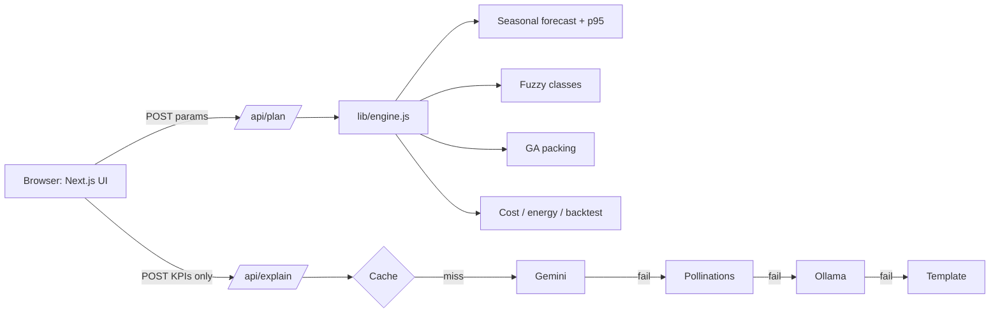
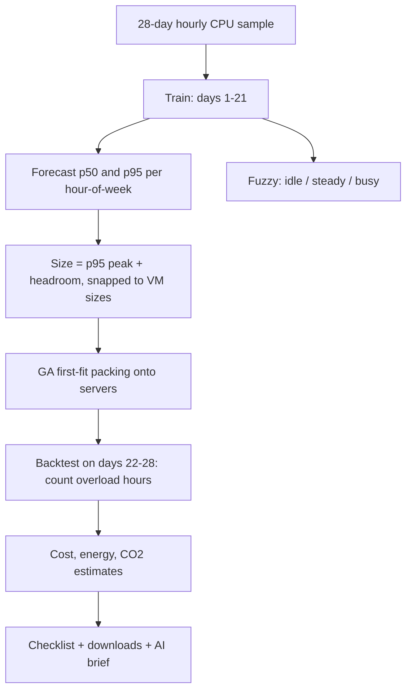

<div align="center">

# ⚡ IdleWatt
### Stop powering empty servers: shrink waste, show the risk

[](https://nextjs.org) [](https://react.dev) [](https://vercel.com/new) [](https://ai.google.dev/gemini-api/docs/pricing) [](https://pollinations.ai) [](https://ollama.com) [](https://github.com/Azure/AzurePublicDataset/blob/master/AzurePublicDatasetV2.md) [](https://nodejs.org/api/test.html)

</div>

For **data scientists and cloud cost (FinOps) teams**. A transparent, testable alternative to black-box sizing advice. [AWS Compute Optimizer](https://docs.aws.amazon.com/compute-optimizer/latest/ug/what-is-compute-optimizer.html) already recommends sizes; IdleWatt shows every step and checks the plan on held-out days.

## Features
| Area | What it does |
|---|---|
| Forecast | Hour-of-week CPU demand with a p95 safety range |
| Soft computing | Fuzzy idle / steady / busy scores; genetic algorithm packs VMs on fewer servers |
| Business view | Estimated cost, kWh, CO₂ before vs. after |
| Risk | Backtest: sized on weeks 1-3, overloads counted on week 4 |
| AI brief | Cache → Gemini → Pollinations → Ollama → template. **No paid API anywhere** |
| Exports | VM plan CSV, full plan JSON, AI brief MD, checklist MD |
| Guides | Pre-change checklist, glossary, how-to tab |
| Quality | `node --test` unit tests, deterministic seeds, works with zero keys |

## Architecture


## Workflow


## Data
Real data comes from [AzurePublicDataset V2](https://github.com/Azure/AzurePublicDataset/blob/master/AzurePublicDatasetV2.md) (links: `AzurePublicDatasetLinksV2.txt`). `data/azure_sample.json` is already built and committed (about 1 MB). To rebuild or enlarge it (streams ~180 files of ~856 MB, never stores them, ~50 min on one core, resumable):
```bash
python3 scripts/build_real_sample.py --parts parts --files 180 --last 180 --vms 300 --hours 660 --workers 4 --merge
```
Re-run the same command if interrupted; finished files are skipped. Drop `--merge` to only download and scan.

## Run locally
```bash
npm install
npm test
npm run dev   # http://localhost:3000
```
## Deploy on Vercel
Push to GitHub → **Import project** on Vercel → Deploy. No environment variables are required. Optional: `GEMINI_API_KEY` (free tier; check your daily limit). Ollama only works locally because Vercel cannot reach your machine.

## Honest limits
- Default data is **real**: 269 long-running VMs from the Azure Public Dataset V2, 660 hourly points each (27.5 days). Sized on the first 504 h (3 weeks), tested on the last 156 h. A synthetic mode stays available for demos.
- The sample is biased to long-running VMs (alive the whole window), and many are very low-use, so "idle" counts are high. It is one region, not a universal fleet.
- The 30-day p95 of **max** CPU (real, from `vmtable`) is compared with hourly **average** CPU from the window; the plan sizes on the higher, so it is conservative.
- CPU alone cannot prove a smaller size is safe. Memory, IO and bursts are not modelled.
- Cost, kWh and CO₂ use editable constants (server $/h, 150-400 W power curve, 0.4 kg/kWh): estimates only.
- Free LLM tiers have rate limits; cached and template answers keep the app working.

## Layout
`app/` UI + API routes · `lib/engine.js` forecast, fuzzy, GA, cost · `tests/` unit tests · `scripts/build_real_sample.py` real-data builder · `data/azure_sample.json` real sample
