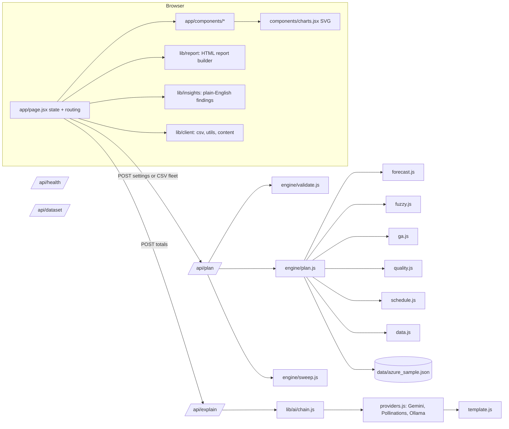

# Architecture

## Layers
| Layer | Folder | Rule |
|---|---|---|
| Presentation | `app/components`, `app/page.jsx` | No business logic; props in, JSX out |
| API | `app/api/*` | Thin: validate, call engine/AI, return JSON |
| Domain engine | `lib/engine/*` | Pure functions, deterministic given a seed |
| Narrative | `lib/insights`, `lib/report`, `lib/ai` | Turn numbers into words; AI always has a fallback |
| Data | `data/`, `scripts/` | Real sample plus a resumable builder and validator |
## Data flow for one request
settings -> `validateFleet` (uploads only) -> `generate` or sample -> per machine: `forecast` -> size -> `fuzzy` -> `offHours` -> `pack` (GA) -> heat map backtest -> `assessQuality` -> KPIs. `sweep` repeats this 18 times for the trade-off chart.
## Design decisions
* **No chart or stats library**: charts are small SVG components that also render inside the downloadable report.
* **Report built in the browser**: Next.js blocks `react-dom/server` in route handlers, and a client-built report keeps the server stateless.
* **Seeded randomness**: the same "repeatability code" always gives the same plan, which makes results testable.
